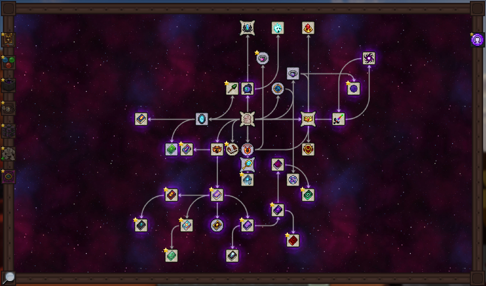

# Forgotten Relics Plus

[English](README.en.md) | 简体中文

Forgotten Relics 的 **Minecraft 1.21.1 / NeoForge** 非官方移植版，加入魔法饰品、典籍与武器，并接入 Thaumaturge 研究体系。

解开复杂度为 **2～8** 的研究笔记，逐步解锁遗物配方，体验传送、念力、防护与天气控制等能力。欧米伽之核研究与配方需要安装 **Re:Avaritia**，并启用 `omega_core.enabled`（默认开启）。在 `config/forgotten_relics_plus-common.toml` 中设为 `false` 可隐藏研究并移除配方，修改后需重启。

## 安装

需要 **NeoForge 21.1.250+、Java 21**，以及以下前置：

- Thaumaturge 1.0.2+
- Lithostitched 1.8.0+
- Botania 457-SNAPSHOT+
- Curios 9.0.0+

[下载](https://github.com/BeiWuCN/Forgotten-Relics-Plus/releases) · [问题反馈](https://github.com/BeiWuCN/Forgotten-Relics-Plus/issues) · [MC 百科](https://www.mcmod.cn/class/28217.html)

## 开发

使用 Java 21 和 PowerShell 7。按 [依赖说明](libs/README.md) 准备依赖后执行 `./gradlew clean build`。修改研究后执行 `./gradlew runData`，并提交生成资源。IDEA 同步 Gradle 后可使用 Client、Server、Data 配置。

## 来源与许可

本模组的行为参考 **Nyonio（NNYYOONNIIOO）及贡献者**开发的 [Forgotten Relics: RE](https://www.curseforge.com/minecraft/mc-mods/forgotten-relics-re)，**已取得作者同意**；美术资产参考 **Integral（Extegral / VictorShadow）**创作的原版 [Forgotten Relics](https://github.com/jss2a98aj/Forgotten-Relics)。

与前作相比，Plus 面向 **Minecraft 1.21.1 / NeoForge**，适配 Thaumaturge 的研究与充能体系，加入研究笔记配方解锁和条件加载的欧米伽之核研究，并重做召唤物的觅敌、运动与渲染。

本项目代码采用 [MIT](LICENSE) 协议；参考项目及原版资产保留各自的许可与署名。
